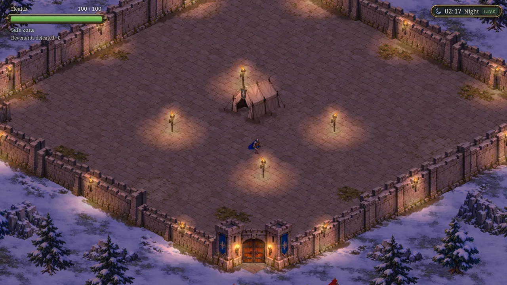
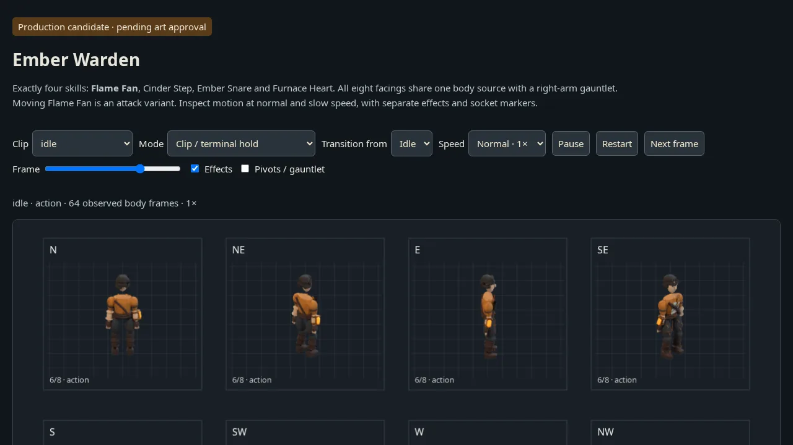
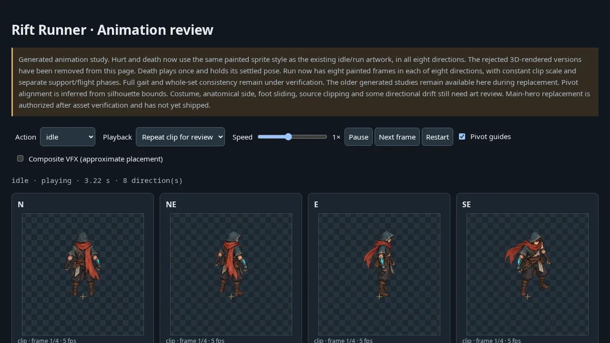

# One Arkadia sandbox — 22 October 2026

The four public sandboxes (`arkadia-stronghold`, `arkadia-coop`, `arkadia-enemies`, `ember-warden-review`) were merged into one custom sandbox, `arkadia` (`CS3d5f22197da69327e209c1c5`), and deleted.

Live: https://arkadia-custom-whachat.fural.space/ — `arkadia-whachat.fural.space` is still bound to the sandbox deleted on 20 October (`sandbox-domains update --subdomain arkadia` answers "hostname already bound", and no visible binding holds it), so the platform added `-custom`.

## Routes

| Path | Content | Former host |
|------|---------|-------------|
| `/` | Game, co-op build `165cd2f` (`feat/coop-server`); invite links `/?room=CODE` | arkadia-coop |
| `/?build=stronghold` | Game, latest `feat/stronghold` build (camera spring); sticky cookie, `/?build=coop` switches back | arkadia-stronghold |
| `/ws`, `/api/rooms/{code}`, `/healthz` | Co-op Go server on 127.0.0.1:3001 | arkadia-coop |
| `/rift-runner/v1/`, `/rift-runner/v2/`, `/knight-footfalls/review.html`, every review folder | Unchanged paths | arkadia-stronghold |
| `/evidence/…` | Evidence that sat in the old sandbox's `dist/` but was no longer served (Knowledge links to it were already 404) | arkadia-stronghold |
| `/enemies/v1/` (`/enemies` redirects) | Ashfang & Mire Imp review | arkadia-enemies |
| `/ember-warden-review/` | Ember Warden review | ember-warden-review |
| `/arkadia-sandbox/` | These screenshots | — |

The two game builds cannot share `/` side by side: both routers rewrite every path to `/`, and the fresh-build check fetches `/` and reloads on a different bundle. So the gateway picks the page per request (query, then cookie, default co-op). A trial merge of `feat/coop-server` into `feat/stronghold` conflicts in `src/stronghold/world-view.ts` and `vite.config.ts`; once the branches are merged, publish one build and drop the switch.

## How it was moved

1. Each Node sandbox kept its files in memory from gzip layers. `dump-site.mjs` ran the same loader and wrote the final file map to disk instead of listening (stronghold 909 files, enemies 36, ember 119); the co-op release tarball was copied as is.
2. Collisions: only `/index.html` differed (two game builds); the 32 other shared paths (`/assets/characters/*`) were byte-identical.
3. The merged tree (1,087 files, 543 MB) was seeded once as tarball parts; `gateway.mjs` serves it from disk (gateway about 55 MB RSS plus 5 MB for the Go server, against 750 MB for the old in-memory stronghold server; 587 MB disk against 1.2 GB for the four homes).
4. Parity: every old path was requested at its new URL — 1,117 of 1,121 byte-identical; the other 4 are retired `.html` pages that redirect to `/` exactly as before.
5. The Ember review was republished from commit `fc820f9` (the peer deploy that landed right after the dump): 120/120 files identical.
6. 55 Knowledge pages (691 links) were repointed; 681 answer 200, the 2 redirects are retired pages, and 5 `/evidence/` images plus `ember-warden-review/evidence/live-mobile-loader.png` were cached as 404 at the CDN edge for up to 4 hours before they were published. The gateway now sends `Cache-Control: no-store` on every error and redirect so this cannot recur.
7. Before deletion, loose files in the old homes (`assets-src/`, `dist/`, ember `sheets/` etc.) and every dump were kept in the member home under `~/arkadia-consolidate/`.

## Releasing

```sh
node scripts/arkadia/publish-layer.mjs --dir DIR --prefix /folder --name NAME   # files at /folder/…
node scripts/arkadia/publish-layer.mjs --dir DIR --build stronghold              # DIR/index.html becomes the Stronghold build
node scripts/arkadia/publish-layer.mjs --tgz release.tgz --build coop            # co-op release (arkadia binary + site/)
node scripts/arkadia/publish-layer.mjs --gateway                                 # gateway.mjs and boot script
node scripts/arkadia/verify-live.mjs                                             # Chromium check → this folder
```

`scripts/ember-warden/publish.mjs` and `scripts/publish-camera-follow.mjs` use `publishLayer`. Older `scripts/publish-*.mjs` still name the deleted `arkadia-stronghold` and stop at their first transfer; port them before reuse. `scripts/fural-deploy.sh` on `feat/coop-server` still targets `arkadia-coop`: replace its transfer/boot steps with `publish-layer.mjs --tgz`.

## Browser check (`results.json`)

| Page | Result |
|------|--------|
|  | `/` loads `index-XETzfG9W.js`, opens `wss://…/ws`, joins room X2PGA (1/4), no page errors |
|  | `/?build=stronghold` loads `index-Dv1iLNWt.js` with the torch-lit court, no page errors |
|  | `/ember-warden-review/` plays 64 observed frames |
|  | `/rift-runner/v1/` |
|  | `/enemies/v1/` |
