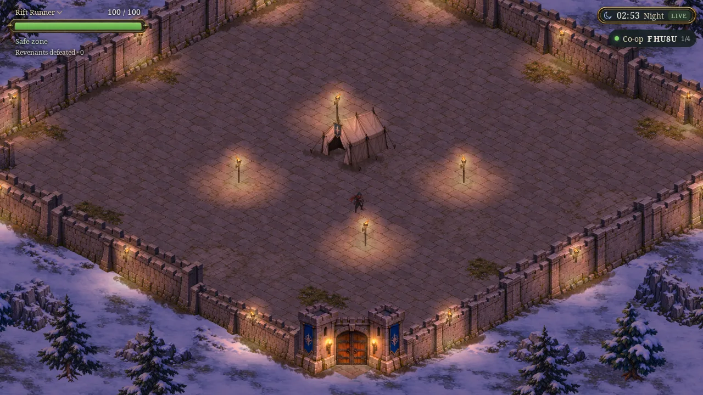
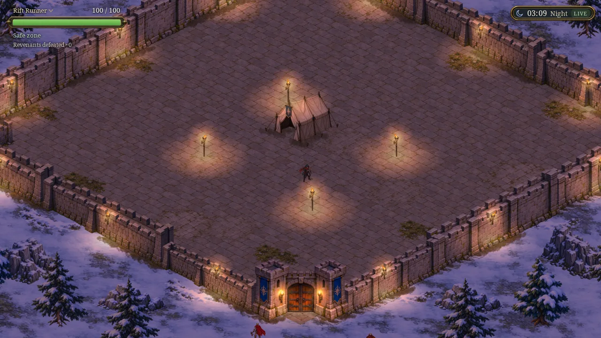
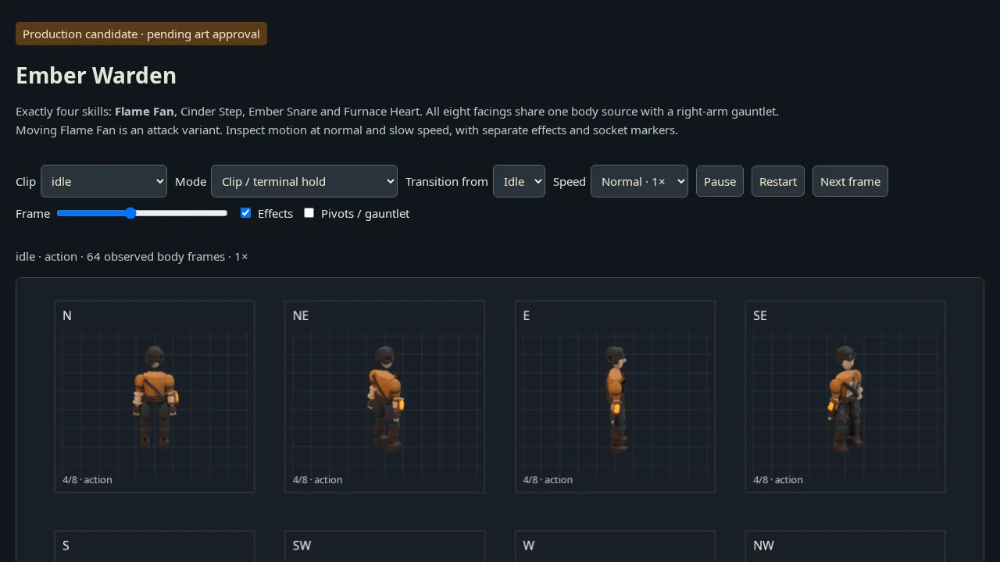
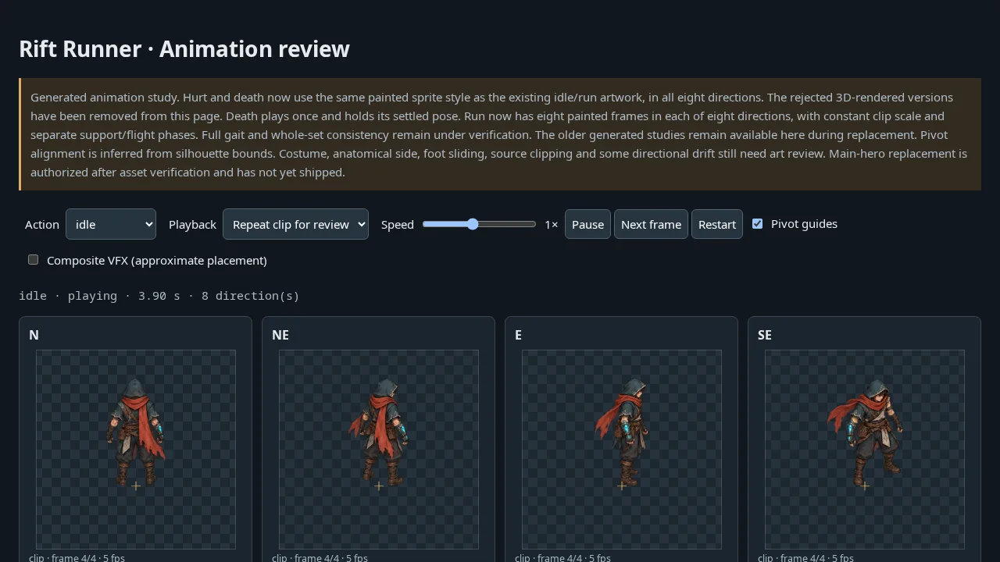
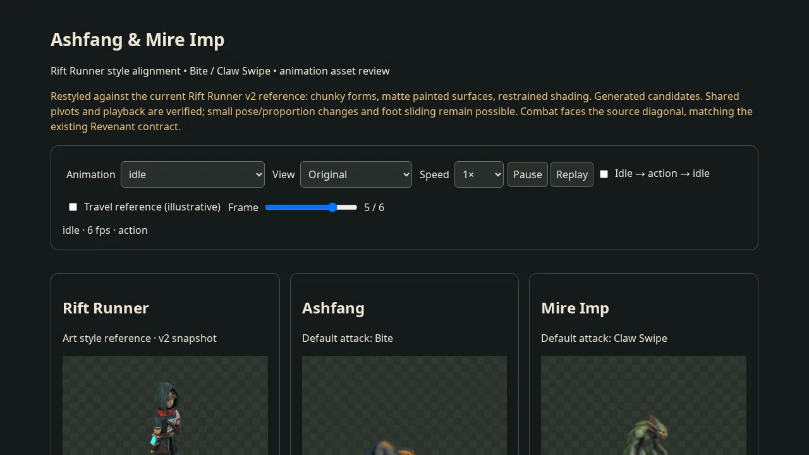

# One Arkodia sandbox — 22 October 2026

Every public preview runs in one custom sandbox, `arkodia` (`CS3d5f22197da69327e209c1c5`): **https://ark-whachat.fural.space/**. The four sandboxes it replaced (`arkodia-stronghold`, `arkodia-coop`, `arkodia-enemies`, `ember-warden-review`) were deleted, and so was their split of the game into a solo and a co-op build: `feat/coop-server` is merged into `feat/stronghold` and one build is served.

## Routes

| Path | Content | Former host |
|------|---------|-------------|
| `/` | The game: solo, or a co-op room via `/?room=CODE`; `?offline=1` (or no reachable server) runs the local simulation | arkodia-stronghold + arkodia-coop |
| `/ws`, `/api/rooms/{code}`, `/healthz` | Go game server on 127.0.0.1:3001 | arkodia-coop |
| `/rift-runner/v1/`, `/rift-runner/v2/`, `/knight-footfalls/review.html`, every review folder | Unchanged paths | arkodia-stronghold |
| `/evidence/…` | Evidence that sat in the old sandbox's `dist/` but was no longer served | arkodia-stronghold |
| `/enemies/v1/` (`/enemies` redirects) | Ashfang & Mire Imp review | arkodia-enemies |
| `/coop/docs/…` | Co-op screenshots and reports | arkodia-coop |
| `/ember-warden-review/` | Ember Warden review | ember-warden-review |
| `/arkodia-sandbox/` | These screenshots | — |

## One game build

The merge (`c01202a`) resolved five conflicts:

- `hero.ts`: the hero keeps the Stronghold's per-frame camera spring, shared occluders, figure shadows and byte-counted loading, and is driven by co-op prediction or snapshots in a room. Only the own hero moves the camera; allies (`party.ts`) are full heroes with the same shadows and cut-outs.
- `encounters.ts`: revenants keep the Stronghold's footprints, occlusion and sun shadows; in a room they mirror the server. Their loop starts after the hero's frame.
- `lighting.ts`: the server's clock in a room, the torch toggles everywhere.
- `world-view.ts`: the byte-weighted loader with co-op's net, party and room layout; the camera spring resets on fit.
- `vite.config.ts`: `asset-sizes.json` plus the `/ws` and `/api` dev proxy.

The Go server now walks revenants as the solo game does (`server/internal/sim/world.go` `move`): footprints block them, they veer round trunks to the side they last turned, and they drop wander targets they cannot reach. `TestRevenantsWalkRoundFootprints` fails without the veer and passes with it. The camp collision export (`node scripts/export-coop-nav.mjs`) was re-run and is unchanged, so client prediction and server still agree.

Checks on the merged tree: `npm run build`, `go test ./...`, `test-stronghold` (8), `test-daylight` (13), `coop-smoke` (ok), `coop-browser` (two tabs, ok), `verify-encounters` (320/390/1440), `verify-enemy-bounds` (0 blocked samples, routes round the tree), `verify-camera-follow` (PASS). Live, after `scripts/fural-deploy.sh`: `DEMO_URL=https://ark-whachat.fural.space node scripts/coop-browser.mjs` ok (RTT 30–44 ms, largest prediction correction 5.4 px) and `scripts/arkodia/verify-live.mjs` without page errors.

## How the sandboxes were moved

1. Each Node sandbox kept its files in memory from gzip layers. A dump script ran the same loader and wrote the final file map to disk (stronghold 909 files, enemies 36, ember 119); the co-op release tarball was copied as is.
2. Only `/index.html` collided (the two game builds); 32 other shared paths were byte-identical.
3. The merged tree (1,087 files, 543 MB) was seeded once; `gateway.mjs` serves it from disk (gateway about 55 MB RSS plus 5 MB for the Go server, against 750 MB for the old in-memory stronghold server; 587 MB disk against 1.2 GB for the four homes).
4. All 1,121 old paths were requested at the new host. Everything is byte-identical except the files this work updated (the game page and `asset-sizes.json`, the co-op evidence, the Ember QA notes) and 4 retired `.html` pages that redirect to `/` as before.
5. Before deletion, every old home and dump was archived in the member home under `~/arkodia-consolidate/`.
6. Links to the retired hosts were repointed in 55 Knowledge pages and in the repository's docs and scripts. Errors and redirects are `Cache-Control: no-store`, so the CDN can no longer pin a 404 over a later release.

## Releasing

```sh
scripts/fural-deploy.sh                                                        # the game (also `fural-agent repos ship`)
node scripts/arkodia/publish-layer.mjs --dir DIR --prefix /folder --name NAME   # a review page or evidence at /folder/
node scripts/arkodia/publish-layer.mjs --gateway                                # gateway.mjs and the boot script only
node scripts/arkodia/verify-live.mjs                                            # Chromium check → this folder
```

A layer never carries the game page; a game release also installs the gateway from the same commit. `scripts/ember-warden/publish.mjs`, `scripts/publish-rift-runner.mjs` and `scripts/rift-runner/publish-prototype.mjs` publish layers. The 34 per-feature `scripts/publish-*.mjs` one-offs that patched the retired `arkodia-stronghold` loader were removed: each release they made is already part of the site, and running one would have rolled the game back.

## Browser check (`results.json`)

| Page | Result |
|------|--------|
|  | `/` opens `wss://…/ws` and joins a room; torch posts and court from the Stronghold, co-op badge from the server; no page errors |
|  | `/?offline=1`: the same build with the local simulation; no page errors |
|  | `/ember-warden-review/` plays 64 observed frames |
|  | `/rift-runner/v1/` |
|  | `/enemies/v1/` |
