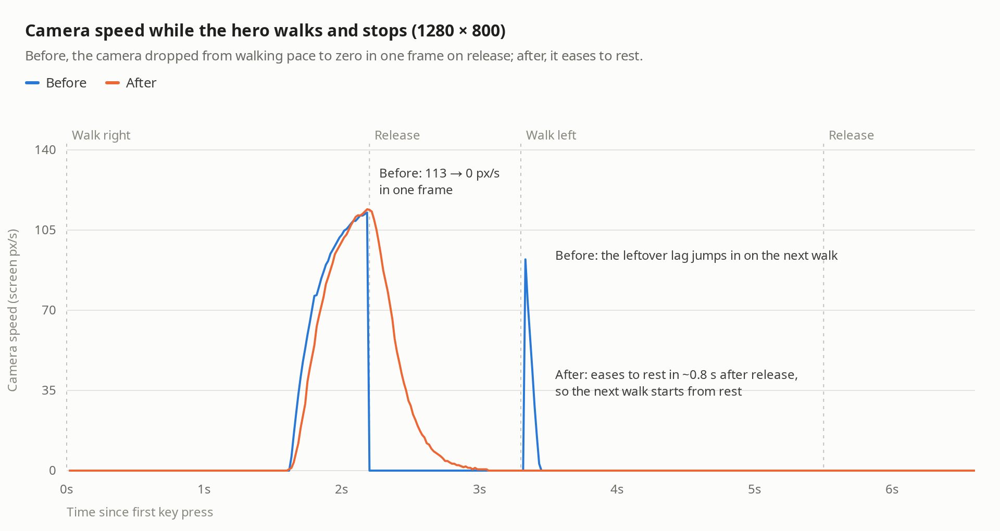

## Smooth camera follow

The camera felt janky while walking. Three causes, all fixed:

1. **Dead stop on release.** The hero only moved the camera while walking. Exponential easing trails a walking hero by ~20 px, so on release the camera dropped from walking speed (~113 px/s) to zero in one frame. The next walk then snapped the leftover lag in as a ~90 px/s spike.
2. **Camera moved inside sub-steps.** On slow frames the hero loop updated the camera once per 34 ms physics sub-step, not once per frame.
3. **Revenants and the HP bar lagged a frame.** Their loop ran before the hero's, so they drew with last frame's camera and shook against the world by 4 px on desktop and 10 px on a 4× throttled phone.

### Fix

- `world-view.ts`: the follow is a critically damped spring (Unity-style SmoothDamp, 0.22 s lag) toward the same central dead-zone box. Velocity stays continuous through starts, turns and stops, it never overshoots, and the camera keeps settling for ~0.8 s after the hero stops. A drag, pinch, building focus or fit takes control and clears the spring. Respawn and teleport (one step of a second or more) land exactly.
- `hero.ts`: physics still sub-steps, but the camera moves once per frame, every frame, so it can settle after the hero stops.
- `encounters.ts`: the loop starts after the hero's (`start()`), so revenants and the HP bar draw with this frame's camera.

### Measurements

`node scripts/measure-camera-follow.mjs` walks right for 2.2 s, stops, walks left and stops, recording each frame. Headless Chromium; this machine was heavily loaded during the runs.

| | Desktop before | Desktop after | Phone 4× CPU before | Phone 4× CPU after |
|---|---|---|---|---|
| Hard stops from walking speed | 1 (113 px/s) | 0 | 2 (112, 126 px/s) | 0 |
| Largest frame-to-frame speed change | 112.7 px/s | 12.3 px/s | 125.8 px/s | 42 px/s |
| HP bar drift against the hero | 3.9 px | 0 | 10.4 px | 0 |

Raw reports with per-frame traces: `before-*.json`, `after-*.json`. Re-render the chart with `node scripts/chart-camera-follow.mjs`.

`node scripts/verify-camera-follow.mjs` checks that a drag during the settle wins, walking resumes the follow, the camera comes to rest, a building tap glides without interruption, and a teleport snaps with nothing left to settle. `verify-hero-walk`, `verify-encounters` and `verify-pinch-zoom` still pass. Set `VERIFY_URL` to run either script against the deployed build.

### Release

Merged as a431576 on feat/stronghold and deployed from a clean build to the canonical Stronghold sandbox with `node scripts/publish-camera-follow.mjs` ([live](https://arkadia-custom-whachat.fural.space/)). Against the live URL, `verify-camera-follow` passed and `measure-camera-follow` recorded no hard stops, a largest frame-to-frame speed change of 19.2 px/s and 0 px HP bar drift (`after-live.json`).
