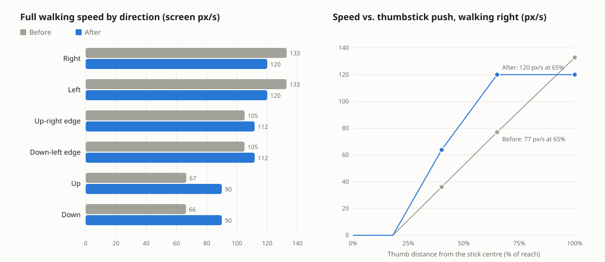

## Even, eased hero walk

Players said the hero's walk felt uneven, sometimes fast and sometimes slow, and not satisfying. Measured on a phone viewport (390×844), solo and co-op, three causes:

1. **Direction changed the speed by 2×.** The walk kept one ground speed. On the 2:1 map that meant 133 px/s across the screen and only 66 px/s up or down. With a thumbstick, every small drift of the thumb's angle sped the hero up or slowed it down.
2. **Thumb distance changed the speed.** Speed grew linearly all the way to the rim of the stick's 40 px reach. A thumb resting at 65% of the reach walked at 58% speed (77 px/s), and at 40% of the reach at 27%.
3. **No easing.** The hero reached full speed in one frame and stopped dead in one frame.

### Fix

- **One speed rule** (`src/stronghold/net/movement.ts`, mirrored by `server/internal/sim/world.go` `WalkStep`): full speed lies on a 4:3 ellipse in screen space, 120 px/s across, 90 up/down and 112 along a tile edge. This keeps a hint of depth (an equal screen speed had walked up and down twice as fast over the ground, an earlier complaint) without the 2× swing. A shorter input vector walks proportionally slower.
- **Eased input** (`src/stronghold/controls.ts`): the walk vector chases the keys or stick with short time constants. The hero gathers speed over about 0.1 s and comes to rest over about 0.15 s. The co-op server receives the eased vector, so its prediction and the server still share one rule.
- **Stick curve** (`controls.ts`): full speed from 60% of the stick's reach. A light push past the dead zone still walks slowly.
- **Leg timing** (`src/stronghold/hero.ts`): legs follow seconds walked at full speed. Each walk clip plays at its authored frame rate at full speed in every direction and slows with the hero.

| | Before | After (solo) | After (co-op) |
|---|---|---|---|
| Full speed range across directions | 66–133 px/s (2.0×) | 90–120 px/s (1.33×) | 90–120 px/s (1.33×) |
| Stick at 65% of its reach, walking right | 77 px/s | 120 px/s | 120 px/s |
| Time to 90% speed | 0–1 frame | 83–133 ms | 67–150 ms |
| Time to rest after release | 0–3 frames | 117–167 ms | 133–217 ms |
| Mean frame-to-frame speed jitter | 4.0% | 2.3% | 2.2% |
| Walk clip frame rate at full speed | ~10 fps | ~10 fps | ~10 fps |

### Live

Release `game-c0ea00f` on https://ark-whachat.fural.space/ (co-op, phone viewport, `live-coop.json`): full speed 90–120 px/s in every direction (1.33×), a thumb at 65% of the stick's reach walks at 120 px/s, 100–167 ms to 90% speed, 150–283 ms to rest, mean jitter 2.3%. The served `main` chunk is byte-identical to this build.

### Not changed

In co-op the client sends inputs up to 5% faster or slower to keep the server's input queue short (`net/client.ts`), and each input walks one full 50 ms step. On a jittery network the own hero therefore still varies by up to about 5% (`docs/coop/smoothness-mobile-after.json`). That is part of the co-op netcode design, and this change leaves it alone.

### Reproduce

- `node scripts/measure-walk-feel.mjs` walks every key direction and the thumbstick at four angles (and their opposites) and 16/26/40 px out, sampling every frame. `MODE=coop` runs it through the Go server, and `ROOT=` measures another checkout. Reports: `before-solo.json`, `before-coop.json`, `after-solo.json`, `after-coop.json`.
- `node scripts/chart-walk-feel.mjs` re-renders `speed.png`.
- `node scripts/verify-hero-walk.mjs` asserts the per-direction speeds (median of three runs from the same open spot). `cd server && go test ./...` covers the server rule (`TestFullSpeedByDirection`).
