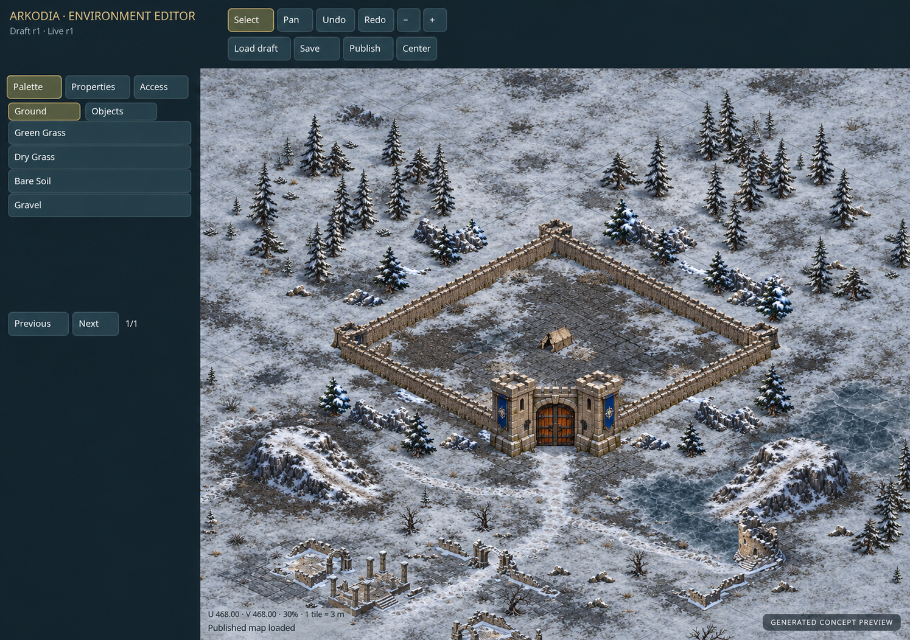

## Frozen Frontier — Generated Editor Concept Preview

Generated concept preview only. The built-in imagegen tool edited a real public editor screenshot captured on 28 October 2026, using the original six-base and transition review sheets. No editor, renderer, catalog, map, gameplay or terrain activation changes.

The recognizable English Pixi editor layout, elevated camera and landmark arrangement are retained. Imagegen re-rendered the image at 1495 × 1052, so UI pixels, props and dimensions are approximate rather than an exact screenshot. Existing Ground labels remain unchanged; they do not imply the pictured Frozen Frontier materials are available tools. The generated label distinguishes the concept from live integration evidence.

Materials: muted dirty snow field, packed snow path, frozen dirt, cracked ice, rocky ground, ruined stone paving, organic blended transitions. This is an artistic interpretation of the existing kit, not byte-for-byte texture mapping or a tiling test.

### Provenance

- Task: bxsditputqgccayxvbsuoohr; source kit task: lrtskdrxdwsrkwnqhiljqgzo.
- Tool: built-in image_gen.imagegen, reference-guided edit, opaque output; one generation, no post-editing.
- Editor: https://arkodia.online/environment-editor/ ; original capture: editor-reference.png (1280 × 900, unmodified screenshot).
- Original kit sheets: review-bases.png (DA5c82b3dafc8955773dde398b) and review-edges.png (DA86e82bf0158cf257eae209f5), reused from staged original discussion downloads.
- Source kit remains live at /frozen-terrain-review/v1/; source-kit-manifest.json preserves its published asset inventory.
- Full exact generation prompt: prompt.txt. Output: concept.png. File SHA-256 inventory: manifest.json.
- Room image: DA0e9b255a80f131e9ba7506e8 in DR7f0a660e4dfc6ca5002753b3.

### Review and delivery

Visually inspected all three references and output: English toolbar/sidebar recognizable; camera and fortress/ruins arrangement preserved; all six material families present with soft transitions. Texture seams and world scale are concept-level, not engine validation. No runtime behavior was changed or tested for this imagery-only task.

Additive prefix-only publish through supported repos ship with scripts/frozen-terrain-concept/deploy.sh and arkodia-deploy.lock. Existing releases, peer WIP, saved maps and GAME_SAVE_DIR are untouched. Public PNG bytes verified using ?format=png to bypass optional WebP delivery.
